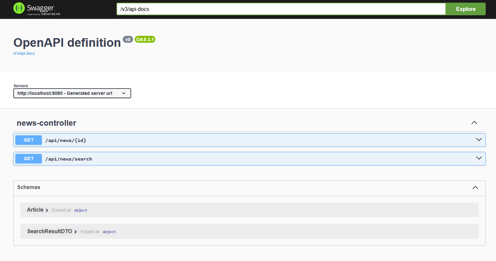

# Semantic News Search with LLM Classification

A weekend project to explore vector databases and LLM pipelines. A Spring Boot service continuously aggregates technology news from RSS feeds, classifies each article with an LLM, stores text embeddings in PostgreSQL/pgvector, and exposes an API for **semantic search** (natural-language query, optionally filtered by category), designed to be consumed by LLM applications.

## Architecture & Tech Stack
* **Framework:** Spring Boot 3.4 (Java 21)
* **AI Integration:** Spring AI, calling any OpenAI-compatible endpoint, configured through environment variables
    * **OpenAI API (default):** `gpt-4o-mini` for classification, `text-embedding-3-small` (768 dimensions) for embeddings
    * **Local and free with Ollama:** e.g. `qwen2.5:0.5b` for classification, `nomic-embed-text` (768 dimensions) for embeddings
    * The project originally ran on GitHub Models, which GitHub retired on 30 July 2026.
* **Vector database:** PostgreSQL with the `pgvector` extension, HNSW index with cosine distance
* **Migrations:** Flyway
* **Testing:** JUnit 5, Mockito, Testcontainers

---

## Prerequisites & Setup

### 1. Model Provider Configuration (Important)
The endpoint, the models and the API key are read from environment variables, so **no key is ever stored in the repository**. Do not paste a key into `application.yml` or any other tracked file; if you prefer a file, use a local `.env` (already listed in `.gitignore`).

| Variable | Default | Meaning |
|---|---|---|
| `OPENAI_API_KEY` | (required) | API key of the provider |
| `AI_BASE_URL` | `https://api.openai.com/v1` | OpenAI-compatible endpoint |
| `CHAT_MODEL` | `gpt-4o-mini` | Model used to classify articles |
| `EMBEDDING_MODEL` | `text-embedding-3-small` | Embedding model (must produce 768-dimensional vectors) |

**Option A: OpenAI API**
```bash
export OPENAI_API_KEY="your_key_here"
```

**Option B: fully local and free with [Ollama](https://ollama.com)**
```bash
docker run -d --name ollama -p 11434:11434 -v ollama:/root/.ollama ollama/ollama
docker exec ollama ollama pull qwen2.5:0.5b
docker exec ollama ollama pull nomic-embed-text

export OPENAI_API_KEY="ollama"            # Ollama ignores the key, but one must be set
export AI_BASE_URL="http://localhost:11434/v1"
export CHAT_MODEL="qwen2.5:0.5b"
export EMBEDDING_MODEL="nomic-embed-text"
```

### 2\. Start the Database

The application relies on a PostgreSQL database equipped with the `pgvector` extension. A `docker-compose.yml` file is provided to easily spin this up:

```bash
docker compose up -d
```

### 3\. Run the Application

Once the database is running, launch the Spring Boot application:

```bash
mvn clean spring-boot:run
```

-----

## Database Migrations (Flyway)

Database schemas are managed automatically using **Flyway**. When the application (or a test) starts, Flyway looks for scripts in `src/main/resources/db/migration/`.

The initial script (`V1__init.sql`) automatically:

1.  Enables the `pgvector` extension.
2.  Creates the `articles` table with a `vector(768)` column for embeddings.
3.  Builds an `HNSW` (Hierarchical Navigable Small World) index using `vector_cosine_ops` to ensure semantic searches are fast.

-----

## API Endpoints & Usage

The API is fully documented using OpenAPI/Swagger. Once the application is running, you can view all endpoints here:
👉 **http://localhost:8080/swagger-ui/index.html**

As you can see in this screenshot, there are two main endpoints: one for fetching articles by ID and another for performing semantic searches.




### 1\. Fetch Article by ID

**`GET /api/news/{id}`**
Retrieves a specific article from the database using its unique UUID.

*Execution and response body for the GET by ID endpoint.*

**Example Response (`43f8b082-b575-4cdf-a32d-0048ded6b3d0`):**

```json
{
  "id": "43f8b082-b575-4cdf-a32d-0048ded6b3d0",
  "title": "CEO of America’s largest public hospital system says he’s ready to replace radiologists with AI",
  "url": "[https://www.reddit.com/r/technology/comments/1s942fa/ceo_of_americas_largest_public_hospital_system/](https://www.reddit.com/r/technology/comments/1s942fa/ceo_of_americas_largest_public_hospital_system/)",
  "summary": "",
  "category": "Artificial Intelligence & Emerging Tech",
  "publishedAt": "2026-03-31T23:41:00Z"
}
```

### 2\. Semantic Hybrid Search

**`GET /api/news/search?query={text}&category={optional}`**
This endpoint takes a natural language query, converts it to a vector using the LLM, and performs a cosine similarity search against the database. It returns the top 3 matches, perfectly preserving the AI's intended order and calculating a human-readable `similarityScore`. It also supports optional Metadata Filtering by Category.

Accepted `category` values (case-insensitive): `CYBERSECURITY`, `AI_AND_EMERGING_TECH`, `SOFTWARE_AND_DEVELOPMENT`, `HARDWARE_AND_DEVICES`, `TECH_INDUSTRY_AND_BUSINESS`, `OTHER`. An unknown category returns `400 Bad Request`.

*Execution of semantic search.*

**Example Query:** `?query=Microsoft faced several security challenges.`

**Example Response:**

```json
[
  {
    "article": {
      "id": "9d8c44e8-58b9-4745-8de0-a7a7e21d267f",
      "title": "Federal cyber experts called Microsoft's cloud a \"pile of shit,\" approved it anyway",
      "url": "[https://arstechnica.com/information-technology/2026/03/federal-cyber-experts-called-microsofts-cloud-a-pile-of-shit-approved-it-anyway/](https://arstechnica.com/information-technology/2026/03/federal-cyber-experts-called-microsofts-cloud-a-pile-of-shit-approved-it-anyway/)",
      "summary": "One Microsoft product was approved despite years of concerns about its security.",
      "category": "Cybersecurity",
      "publishedAt": "2026-03-18T17:36:40Z"
    },
    "similarityScore": 0.5837
  },
  {
    "article": {
      "id": "a716c027-b19e-4452-9e00-0abbf053b240",
      "title": "Microsoft closes worst quarter on Wall Street since 2008 on AI concerns / Microsoft lost almost a quarter of its value in the first three months of the year, its steepest quarterly drop since the 2008 financial crisis.",
      "url": "[https://www.reddit.com/r/technology/comments/1s8z34p/microsoft_closes_worst_quarter_on_wall_street/](https://www.reddit.com/r/technology/comments/1s8z34p/microsoft_closes_worst_quarter_on_wall_street/)",
      "summary": "",
      "category": "Tech Industry & Business",
      "publishedAt": "2026-03-31T20:27:05Z"
    },
    "similarityScore": 0.5192
  },
  {
    "article": {
      "id": "429318d3-0911-411f-8e3a-827438780822",
      "title": "The who, what, and why of the attack that has shut down Stryker's Windows network",
      "url": "[https://arstechnica.com/security/2026/03/whats-known-about-wiper-attack-on-stryker-a-major-supplier-of-lifesaving-devices/](https://arstechnica.com/security/2026/03/whats-known-about-wiper-attack-on-stryker-a-major-supplier-of-lifesaving-devices/)",
      "summary": "Company says it doesn't know how long it will take to restore its Microsoft environment.",
      "category": "Cybersecurity",
      "publishedAt": "2026-03-12T22:18:11Z"
    },
    "similarityScore": 0.4787
  }
]
```

-----

## Testing Strategy

Run the test suite using:

```bash
mvn test
```

*All unit and integration tests passing successfully.*

  * **`AiClassificationServiceTest.java`**: Focuses on the core business logic. We use Mockito to mock the `ChatClient` and ensure our error handling successfully falls back to the `OTHER` category if the LLM returns an invalid or hallucinated response.
  * **`NewsControllerTest.java`**: Tests the web layer using `@WebMvcTest`. We mock the `ArticleRepository` and `VectorStore` to verify HTTP status codes, JSON serialization, and the math logic that calculates the `similarityScore`.
  * **`NewsIngestionSchedulerTest.java`**: Tests the ingestion pipeline with mocked feeds, classifier and vector store. It checks that every new article is embedded, and that when the embedding call fails the just-saved article is rolled back (so it is retried in the next cycle instead of staying unsearchable) and the feed stops.
  * **Testcontainers Integration**: When tests execute, Spring Boot uses Testcontainers to spin up an ephemeral, disposable PostgreSQL/pgvector database. Flyway automatically migrates this temporary database, ensuring tests run in a clean, production-like environment without affecting local data.

-----

## 📁 Repository Structure

The repository strictly adheres to Spring Boot MVC and Clean Architecture best practices, separating concerns into Models, DTOs, Repositories, Services, and Controllers.

```text
.
├── README.md
├── docker-compose.yml
├── pom.xml
├── src
│   ├── main
│   │   ├── java
│   │   │   └── com
│   │   │       └── jpapinto
│   │   │           └── newsfeed
│   │   │               ├── NewsfeedApplication.java
│   │   │               ├── controller
│   │   │               │   └── NewsController.java
│   │   │               ├── dto
│   │   │               │   ├── RawNewsItem.java
│   │   │               │   └── SearchResultDTO.java
│   │   │               ├── model
│   │   │               │   ├── Article.java
│   │   │               │   └── Category.java
│   │   │               ├── repository
│   │   │               │   └── ArticleRepository.java
│   │   │               ├── scheduler
│   │   │               │   └── NewsIngestionScheduler.java
│   │   │               └── service
│   │   │                   ├── AiClassificationService.java
│   │   │                   └── RssFeedService.java
│   │   └── resources
│   │       ├── application.yml
│   │       └── db
│   │           └── migration
│   │               └── V1__init.sql
│   └── test
│       └── java
│           └── com
│               └── jpapinto
│                   └── newsfeed
│                       ├── NewsfeedApplicationTests.java
│                       ├── controller
│                       │   └── NewsControllerTest.java
│                       ├── scheduler
│                       │   └── NewsIngestionSchedulerTest.java
│                       └── service
│                           └── AiClassificationServiceTest.java
```

-----

## Design Decisions & Future Improvements

### 1. Smart API Quota Management (Circuit Breaker)

Hosted model APIs are rate-limited (the GitHub Models free tier this project was first built on allowed only 150 requests per day). To avoid hitting such limits too fast, the app uses two safety features:

* **Limited Batching:** The app only processes a maximum of 5 new articles every time it checks for news.
* **Circuit Breaker:** If an embedding call fails (typically "Too Many Requests", HTTP 429, once the daily quota is used up), the app doesn't crash. Instead, it "trips a breaker": it removes the article it just saved (so it will be retried later rather than stored without an embedding), stops processing that feed to save your quota, and waits for the next 4-hour window. This keeps the app running without manual intervention.

### 2\. Real-Time Processing vs. Event-Driven Architecture

**Current:** News is fetched using Spring's `@Scheduled` annotation, polling the RSS feeds asynchronously.
**Improvement:** To achieve true real-time ingestion, we could implement an Event-Driven Architecture using **Apache Kafka**. A producer service would push raw RSS XML items to a Kafka topic, and consumer microservices would asynchronously process the AI classification and vector embeddings. This would provide immense scalability and robust backpressure handling.

### 3\. Observability

**Current:** The application uses SLF4J for targeted logging, providing a clear console trail of skipped duplicates, classification results, and circuit breaker activations.
**Improvement:** For a production environment, this should be upgraded to the **ELK Stack** (Elasticsearch, Logstash, Kibana). Centralized logging would allow us to set up alerts for when the AI API rate limits are hit, monitor the frequency of the `OTHER` fallback category, and track the average latency of our semantic searches.
